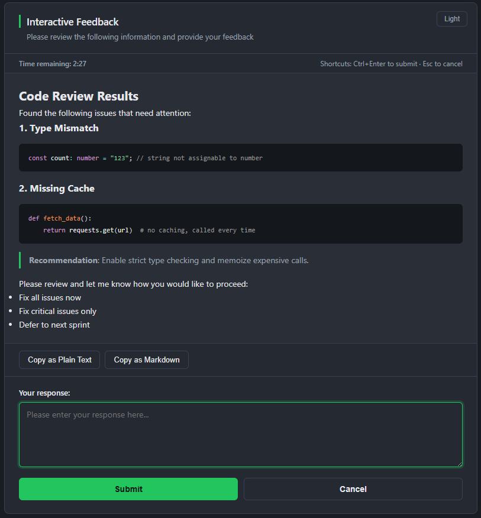

# feedback-mcp-server v3.0.0

一个轻量级的 MCP (Model Context Protocol) 服务器，提供基于浏览器的交互式用户反馈功能，支持完整的 Markdown 渲染和语法高亮。

<p align="center">
  
  
  
</p>

## 🌟 功能特性

<p align="center">
  
</p>

### 🚀 核心功能

- ✅ **轻量级浏览器窗口**：Chrome/Edge App 模式，无地址栏，资源占用低
- ✅ **Markdown 渲染**：完整的 Markdown 支持和语法高亮
- ✅ **完全离线运行**：代码高亮（Prism）本地化打包，无需网络或 CDN 即可工作
- ✅ **可插拔 UI 后端**：默认浏览器富文本；设 `FEEDBACK_UI=native` 改用系统原生对话框（约 10MB 内存，纯文本）
- ✅ **安全防护**：HTML 净化（sanitize-html）+ CSP 防 XSS、脚本块注入转义、会话令牌 + Host 校验防跨站伪造与 DNS rebinding、仅监听 127.0.0.1 不暴露网络
- ✅ **并发安全**：多个对话框调用自动排队串行展示，互不冲突
- ✅ **智能复制**：支持复制为纯文本或 Markdown 格式
- ✅ **多语言界面**：中文和英文界面切换
- ✅ **超时控制**：可配置超时时间；超时与主动取消语义分离，提前结束时保留未提交草稿
- ✅ **多浏览器支持**：Chrome / Edge（App 模式）、Firefox / Safari（普通窗口）
- ✅ **跨平台支持**：Windows、macOS 和 Linux

## 📦 安装

### 方式 1：使用 npx（推荐）

无需预先安装，可直接在 Claude Desktop 中使用。以下示例固定为 `3.0.0`，升级时请先验收再修改版本；`@latest` 会随新版本发布而变化。

**从 2.x 升级**：先确认 Node.js ≥ 22.12.0，再重启 MCP 服务。旧 MCP 客户端、`interactive_feedback` 参数和返回字段保持兼容。`FEEDBACK_TIMEOUT` 使用秒，10 分钟填 `600`；客户端还需单独配置工具等待预算，见下文。

```json
{
  "mcpServers": {
    "feedback": {
      "command": "npx",
      "args": ["-y", "feedback-mcp-server@3.0.0"],
      "env": {
        "FEEDBACK_TIMEOUT": "300",
        "FEEDBACK_LANGUAGE": "zh",
        "FEEDBACK_THEME": "auto"
      }
    }
  }
}
```

### 方式 2：全局安装

```bash
npm install -g feedback-mcp-server@3.0.0
```

配置：

```json
{
  "mcpServers": {
    "feedback": {
      "command": "feedback-mcp-server",
      "env": {
        "FEEDBACK_TIMEOUT": "300",
        "FEEDBACK_LANGUAGE": "zh",
        "FEEDBACK_THEME": "auto"
      }
    }
  }
}
```

## ⚙️ 配置

### 环境变量

| 环境变量 | 描述 | 默认值 |
|---------|------|--------|
| `FEEDBACK_TIMEOUT` | 对话框超时（秒），非法回退 300，合法值钳制到 [5, 86400]（1 天） | 300 (5 min) |
| `FEEDBACK_LANGUAGE` | browser 界面语言（`zh` / `en`，非法值回退 `zh`）；不控制 AI 回复语言；native 标签使用英文 | zh |
| `FEEDBACK_UI` | UI 后端：`browser`（富文本）/ `native`（系统对话框）/ `auto`（检测 native 工具存在，缺失时回退 browser）；native 需要图形会话 | browser |
| `FEEDBACK_THEME` | browser 主题：`auto`（跟随系统）/ `light` / `dark`；保存的手动主题优先，native 使用系统样式 | auto |
| `FEEDBACK_PORT` | browser 后端监听端口（选填）：`0` 随机（默认）；设固定端口（如 `17841`）可让主题偏好跨会话记忆 | 0（随机） |

配置在 MCP 服务器进程启动时读取，修改后需重启该服务。v2.1 已将 `FEEDBACK_TIMEOUT` 从毫秒改为秒：10 分钟填 `600`，旧值 `600000` 会被限制为 86400 秒。已移除的 `FEEDBACK_MAX_TOKENS` 不再限制消息或模型输出；旧参数和异常超时会在 stderr 提示，日志不打印原始配置值。

### 客户端等待预算

`FEEDBACK_TIMEOUT` 控制弹窗，客户端另有启动和工具调用超时。客户端更早取消时，服务器结束当前会话。弹窗超时不含队列等待，客户端预算须覆盖排队、处理和收尾。下面的 660 秒是单次 10 分钟交互的示例，并发排队需另估预算。

Codex 的配置文件为 `~/.codex/config.toml`。以下配置使用 npm 固定版本。桌面应用需能找到 `npx`；如使用源码构建，先 `npm ci --ignore-scripts && npm run build`，再把启动命令改为 Node 可执行文件绝对路径，参数改为 `dist/index.js` 的绝对路径。

```toml
[mcp_servers.feedback]
command = "npx"
args = ["-y", "feedback-mcp-server@3.0.0"]
enabled = true
startup_timeout_sec = 60
tool_timeout_sec = 660

[mcp_servers.feedback.env]
FEEDBACK_TIMEOUT = "600"
FEEDBACK_LANGUAGE = "zh"
FEEDBACK_THEME = "auto"
```

ZCode 使用 `~/.zcode/cli/config.json` 中的 `mcp.servers`，工具预算字段是毫秒单位的 `timeoutMs`。它导入其他 Agent 配置后保存自己的副本；后续修改原配置不能代替修改 ZCode 配置。

```json
{
  "mcp": {
    "servers": {
      "feedback": {
        "type": "stdio",
        "command": "npx",
        "args": ["-y", "feedback-mcp-server@3.0.0"],
        "enabled": true,
        "timeoutMs": 660000,
        "env": {
          "FEEDBACK_TIMEOUT": "600",
          "FEEDBACK_LANGUAGE": "zh",
          "FEEDBACK_THEME": "auto"
        }
      }
    }
  }
}
```

Claude Code 的 `MCP_TIMEOUT` 是启动预算，`MCP_TOOL_TIMEOUT` 是工具预算，均使用毫秒，应配置在 Claude Code 的宿主环境或其支持的服务级超时字段中。把它们写入 feedback 的 `env` 只能传给子进程，不能修改父客户端的预算。

Codex 返回 `Script running with cell ID ...` 代表包装执行仍在运行。Agent 应继续等待同一调用，直到实际完成、明确取消或真实超时；分段返回不能作为终止、重复打开弹窗或默认审批的依据。该规则能提示 Agent 正确等待，服务器无法强制宿主继续等待。排查“不到 60 秒就结束”时，核对该次调用的版本、有效超时、`exec/wait`、取消和返回记录，分别判断。

浏览器在客户端取消、超时或其他窗口提交后保留尚未提交的草稿，提示复制后手动关闭；用户主动点击取消仍按原流程结束。网络故障或结果未知时先核对原会话，不自动重发回复。

客户端字段依据：[Codex MCP](https://developers.openai.com/codex/mcp/)、[ZCode MCP](https://github.com/zai-org/ZCode/blob/main/apps/zcode-cli/docs/usage/07-mcp.md)、[Claude Code 环境变量](https://code.claude.com/docs/en/env-vars)。

**推荐配置：**
```json
{
  "env": {
    "FEEDBACK_TIMEOUT": "300",
    "FEEDBACK_LANGUAGE": "zh",
    "FEEDBACK_THEME": "auto"
  }
}
```

## 🎯 使用方式

AI 会自动调用 `interactive_feedback` 工具，浏览器会打开对话框显示消息内容。

### 工具参数

- `message` (必填): 要显示给用户的消息内容，支持完整的 Markdown 格式；非空，上限 1,000,000 字符（超限会收到明确的校验错误而非弹窗）

### 返回值

```json
{
  "submitted": boolean,   // 用户是否提交了响应
  "response": string,     // 用户输入的内容
  "timedOut": boolean,    // 是否超时（与主动取消区分）
  "error": string         // 对话框未能展示时的错误说明（如浏览器启动失败），同时以 isError 返回
}
```

> 语义约定：`submitted=false` 且无 `error` 表示用户主动取消或超时；带 `error` 表示对话框本身出现故障（AI 不应将其误读为用户取消）。

## 🔒 边界与安全

- **输入边界**：`message` 非空且 ≤ 1M 字符；HTTP 提交体 ≤ 1MB；用户响应 ≤ 1M 字符（超出截断并附明确标记）
- **超时边界**：钳制在 [5s, 86400s]，杜绝超长定时器溢出导致的"秒退"
- **XSS 纵深防御**：sanitize-html 白名单净化 + CSP + nosniff + `X-Frame-Options: DENY` + 内嵌 JSON 的 `</script>` 转义
- **本地服务加固**：仅绑定 `127.0.0.1`；`/submit` `/cancel` `/timeout` 需携带页面持有的随机会话令牌（防本机其他网页跨站伪造）；Host 头白名单（防 DNS rebinding）；Prism 静态资源路径遍历防护
- **进程稳定性**：子进程 stdin/stdout 异常全部兜底（用户秒关对话框不再可能击穿服务器）；HTTP 服务结束后彻底销毁连接，无端口/句柄泄漏
- **窗口生命周期**：本窗口提交成功或用户主动取消后尝试自动关闭；客户端取消、超时或其他窗口提交时保留未提交草稿，供用户复制后手动关闭。冷启动后晚到的窗口显示"会话已结束"收尾页
- **并发**：并发的工具调用按 FIFO 排队，一次只展示一个对话框
- **调用取消**：MCP 客户端取消后，排队请求不再弹窗；活动后端收到取消信号，浏览器通过本机会话事件流显示终态
- **结果确认**：页面以本次提交的服务端确认判定成功；过期提交和网络故障保留回复内容，提示先核对结果，不自动重试
- **固定端口复用**：下一次监听等待旧服务关闭，保留晚到窗口收尾页；冷启动时等待最长仍为 30 秒

## 🎨 界面特性

- **Markdown 渲染**：完整支持代码高亮、表格、列表等
- **智能复制**：支持复制为纯文本或 Markdown 格式
- **快捷键**：`Ctrl + Enter` 提交，`Esc` 取消
- **多语言界面**：中文和英文切换

## 📝 使用示例

### 简单确认

```json
{
  "message": "是否继续执行删除操作？此操作不可逆。"
}
```

### 代码审查结果

```json
{
  "message": "## 代码审查结果\n\n发现以下问题：\n\n1. **类型错误**\n   ```typescript\n   const x: string = 123; // 类型不匹配\n   ```\n\n2. **性能问题**\n   - 未使用缓存\n   - 重复计算\n\n请确认是否修复？"
}
```

## 🛠️ 技术栈

- **Node.js** + **TypeScript**
- **MCP SDK**：@modelcontextprotocol/server v2，兼容旧握手与 2026-07-28 协议
- **Markdown 渲染**：marked + Prism.js（本地化，离线可用）
- **安全净化**：sanitize-html（剥离脚本/事件属性，防止 XSS）

## 🧪 开发与测试

```bash
npm ci --ignore-scripts
npm run check      # TypeScript 类型检查
npm run build      # TypeScript 编译到 dist/
npm test           # 单元、HTTP、页面逻辑、原生进程和真实 MCP 协议回归
npm run test:package # 临时安装 tarball，验证入口、离线资源和 MCP 反馈链路
npm run test:e2e   # 端到端冒烟（真实 MCP 握手 + 真实窗口，会短暂弹窗）
```

安装时关闭依赖生命周期脚本，根项目构建和测试由上述命令显式执行。`npm pack` 会自动运行 `prepack`，重新编译并检查包文件。`test:package` 清理自己创建的临时目录，把验证通过的同一份 tarball 保留在 Git 忽略的 `tmp/feedback-release/`；手动发布流程直接使用这份文件，不重新打包。

GitHub Actions 配置覆盖 Windows/macOS/Linux 与 Node.js 22.12.0、24 LTS。`Publish` 等待六组验证全部通过，仅能手动运行，要求选定与 `package.json` 一致的 `vX.Y.Z` tag；需先在 GitHub 配置 `npm-publish` environment 的审批规则，并在 npm 绑定此仓库、`publish.yml` 和该 environment 的 trusted publisher，启用直接 `npm publish` 的权限。CI 发布使用 OIDC、provenance 和 CycloneDX SBOM，不保存长期 npm token；发布文件按当前版本精确选取，避免混入旧 tarball。

lockfile 固定源码构建的依赖树；npm 消费者安装仍遵循包声明的依赖解析规则。CI 配置、真实 GUI 和 npm 发布状态需要分别验收。

SBOM 包含构建依赖树，以覆盖作为开发依赖安装、但以离线资源进入运行包的 Prism；打包时检查离线核心与 lockfile 安装版本一致。

浏览器消息保留 1,000,000 字符上限。每个会话只运行一次独立 Worker 渲染，预算 2 秒、HTML 输出上限 10 MiB、V8 old-generation 堆上限 128 MiB；超时、异常或超限显示完整转义原文，并保留复制和回复。单段超过 20,000 字符或超出整页 50,000 字符高亮预算的代码保留原文并跳过高亮。

native 纯文本转换复用同一 Worker 预算和取消机制；超预算或异常时直接显示完整原文，不降低 1M 字符上限。转换期间取消不会继续打开原生窗口，队列等待旧线程退出后再处理下一条。默认浏览器启动器的异步进程错误会返回本次调用的 error，MCP 连接继续可用。

HTTP(S) 图片默认显示域名、替代文字和逐张加载按钮，不自动请求外部地址。点击会向目标网站发送请求，暴露网络地址和访问时间；加载失败后由用户决定是否重试。data: 与包内图片保持直接显示。此策略允许手动加载，CSP 仍允许 HTTP(S) 图片，不构成严格离线网络限制。

运行时使用 SDK v2 的 `serveStdio` 同时服务新旧协议。回归保留真实 SDK v1 客户端，覆盖 2024-11-05、2025-11-25 旧握手及 2026-07-28 discover；工具名称、消息参数、回复字段和取消语义保持兼容。v1 SDK 只用于测试，不进入运行时依赖。

## 📋 系统要求

- **Node.js** >= 22.12.0，生产建议使用受支持的 Node.js 24 LTS 补丁版本
- **操作系统**：Windows / macOS / Linux，需满足所选 Node.js 版本的[官方平台要求](https://github.com/nodejs/node/blob/v24.x/BUILDING.md#platform-list)；Node.js 24 的 macOS 最低要求为 13.5
- **浏览器**：Chrome 或 Edge（推荐，App 模式）；Firefox / Safari 亦支持（普通窗口模式）
- **native 后端**：Windows 需 PowerShell（系统自带）；Linux 需 zenity；macOS 使用系统自带 osascript

## 🐛 故障排除

**浏览器没有打开**
- 检查是否安装了 Chrome、Edge、Firefox 或 Safari
- 此时工具会返回带 `error` 的结果（`isError: true`），AI 可据此改用纯文本方式询问

**Firefox / Safari 下窗口带有地址栏**
- 这两种浏览器不支持 App 模式，会以普通窗口打开，属预期行为

**对话框无法提交**
- 检查本机 127.0.0.1 回环是否被防火墙/安全软件拦截

**窗口没有自动关闭**
- Chrome/Edge 的 App 窗口会自行关闭；Firefox/Safari 普通窗口可能拒绝脚本关闭，此时窗口会停留在"会话已结束"提示页，手动关闭即可（属浏览器安全策略，非故障）

**native 模式长消息显示不全**
- v2.2.0 起消息区为可滚动多行文本框，可拉伸窗口；消息经 stdin 传输，不再受命令行 ~32K 字符限制

**中文乱码（Windows native 模式）**
- v2.2.0 起脚本输出走 Base64 信封，与系统代码页无关；如仍出现请升级到最新版

## 📋 更新日志

### v3.0.0
- 最低 Node.js 要求从已发布 v2.2.0 的 18.2 提高到 22.12；旧运行时需先升级，因此使用新的 major 版本。旧 MCP 握手、工具参数和返回字段保持兼容。
- 明确秒单位、已移除参数和各客户端独立超时；启动日志显示版本，异常配置提示不包含原始值。
- 浏览器保留提前结束时尚未提交的草稿；非法提交错误日志不包含回复片段。
- 离线 Prism 与锁定的 1.30.0 核心一致，包含 DOM Clobbering 修复；打包检查阻止离线核心与已审计依赖不一致。
- 发布前强制等待六组平台验证，精确发布当前版本的已验收 tarball。
- 修复固定端口连续调用失败、旧连接复用及 HEAD 请求挂起。
- 贯通 MCP 取消信号，区分真实提交确认与会话结束，覆盖浏览器启动挂起超时。
- 修复 native 错误误报取消、代码注释和比较表达式丢失、Windows 回复静默截断。
- 修复复制反馈异常，补充结果播报和浅色按钮 hover 对比度。
- 提交 lockfile，更新现有 major 范围内依赖，增加构建、包内容检查、安装冒烟及 CI。
- 保留消息上限，隔离并缓存 Markdown 渲染；远程图片逐张确认加载；迁移 SDK v2 并兼容旧客户端。

### v2.2.0
- 🔒 **安全加固（browser 后端）**：`/submit` `/cancel` `/timeout` 增加随机会话令牌校验（防本机恶意网页 no-cors 跨站伪造）；Host 头白名单防 DNS rebinding；显式绑定 `127.0.0.1`；修复消息含 `</script>` 时内嵌 JSON 可逃逸脚本块的注入点（`\u003c` 转义）；CSP 增加 `frame-ancestors 'none'` 与 `X-Frame-Options: DENY`
- 🐛 **修复中文响应被截断损坏**：HTTP 提交体改按 Buffer 收集再一次性 UTF-8 解码（原字符串拼接在多字节字符跨 chunk 时产生乱码，>64KB 中文回复会损坏）；native 后端 stdout 同样修复
- 🐛 **修复 Windows native 长消息失败**：消息改经 stdin 传入（原 argv 传参超 ~32K 字符 spawn 失败）；PowerShell 输出改 Base64 信封，修复中文代码页（CP936 等）乱码
- 🐛 **修复 macOS native 响应丢失**：AppleScript `return` 为 CR（`\r`），原按 `\n` 切分导致提交内容恒为空
- 🛡️ **进程稳定性**：子进程 stdin 挂 error 处理（用户秒关对话框不再可能以 EPIPE 击穿整个服务器）；Windows native 增加 Node 侧看门狗（脚本挂起不再永久卡死工具调用）；HTTP 服务结束后强制销毁全部连接（修 keep-alive 句柄/端口泄漏累积）
- ⚙️ **边界控制**：`FEEDBACK_TIMEOUT` 钳制到 [5, 86400] 秒（防超长定时器溢出立即触发）；`message` 增加非空 + 1M 字符上限校验；用户响应 1M 字符截断保护；请求头/请求体超时约束
- 🚦 **并发串行化**：并发的 `interactive_feedback` 调用自动排队（FIFO），一次只弹一个对话框，各自超时独立计算
- 🧹 **纯文本轻量化修复**：`file_name_here` 等下划线标识符不再被斜体规则吞字；`x < 3 and y > 2` 不再被当 HTML 标签删除；代码块内容经占位符保护不被二次处理；Windows native 消息区改为可滚动多行框（支持超长消息）
- 🪟 **窗口自动关闭与晚到窗口收尾**：对话框结束（提交/取消/超时）后窗口自动尝试自行关闭（Chrome/Edge App 窗口实测生效）；本地服务在结束后延迟关停——浏览器冷启动慢或脚本方秒速提交时，"晚到"的窗口会拿到"会话已结束"收尾页并自行关闭，不再停留在"无法访问此网站"错误页且永不关闭；超时/取消同样显示收尾画面
- ✨ **其他**：浏览器启动失败显式报错（不再伪装成"用户取消"误导 AI）；倒计时改绝对时间计算（修后台标签页节流漂移）；中文输入法组词时 Esc/Ctrl+Enter 不再误触发；新增 `FEEDBACK_PORT` 固定端口选项（主题偏好跨会话记忆）；测试套件 71 项 + 真实 E2E 冒烟脚本

### v2.1.0
- 🐛 **修复 browser 提交大文本失败**：去除响应长度 10000 字符硬限制（保留 1MB 防滥用），修复提交 5-10KB 日志报 HTTP 400
- ⏱️ **FEEDBACK_TIMEOUT 改秒单位**：默认 300s（5 分钟），更直观（原为毫秒）
- 🗑️ **移除 FEEDBACK_MAX_TOKENS**：硬截断输入不利正常使用，改由工具描述引导 AI 控制 message 长度
- 🎨 **主题跟随系统**：新增 `FEEDBACK_THEME`（`auto` 默认跟随系统 / `light` / `dark`），手动切换仍可记忆覆盖
- 🔧 **工具描述精简**：减少 token 占用

### v2.0.0
- 🏗️ **可插拔 UI 后端架构**：拆分 `dialog.ts` 为 `core/`（types、markdown、html-template）+ `backends/`（browser-backend、native-backend），统一 `UIBackend` 接口
- ⚡ **native 后端（省内存）**：新增 `FEEDBACK_UI=native`，调用系统原生对话框（Linux zenity / macOS osascript / Windows PowerShell WinForms），内存从约 300MB 降到约 10MB
- 📝 **Markdown 轻量化**：native 后端自动将 Markdown 转可读纯文本（不支持富文本渲染）
- 🔧 **配置**：新增 `FEEDBACK_UI` 环境变量（选填，默认 `browser`，完全向后兼容）
- 📦 **资源**：Windows native 脚本 `assets/native/win-feedback.ps1` 随包分发

### v1.2.0
- 🎨 **界面重设计**：移除蓝紫渐变与 emoji，采用石墨极简风格（中性灰 + 墨绿强调）；暗色主题改为中性石墨深灰
- 🔒 **安全加固**：引入 sanitize-html 净化 Markdown 渲染输出，防止 XSS；错误提示改用 textContent；新增 CSP / nosniff / Referrer-Policy 安全响应头
- 🐛 **正确性修复**：HTTP 响应统一收口，消除重复写入竞态；超时改为独立端点，修正 `timedOut` 标志丢失；修复 Firefox 下复制按钮失效；submit/cancel 防重入
- 🛠️ **可靠性**：移除不可靠的 Windows `start chrome` 路径，统一浏览器探测；修复 `path`/`process` 变量遮蔽；MCP 握手版本号改为从 package.json 注入
- 📦 **完全离线**：Prism 代码高亮本地化打包（精选常用语言），移除所有 CDN 依赖，无网环境正常工作
- 🌐 **工程化**：补全"提交中/处理中"文案 i18n；`FEEDBACK_TIMEOUT` 下界校验、`FEEDBACK_LANGUAGE` 收紧为 zh/en；升级依赖修复 7 个安全漏洞

### v1.1.2
- 增强错误处理与重试机制
- 新增主题切换、窗口位置记忆、快捷键提示
- 增强浏览器兼容性（Safari/Firefox 支持）

---

<div align="center">
  <sub>
    <p>Made with ❤️ by <a href="https://github.com/NianLog/feedback-mcp">NianLog</a></p>
  </sub>
</div>
